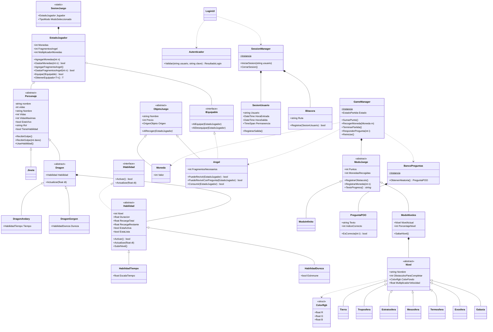

# Catálogo de clases – Sky Dragons (para el diagrama UML)

Estado del código: Login y bitácora, Ángel y modo Infinito incluidos.
Notación: `+` público, `-` privado, `#` protegido, *cursiva* = abstracto. Los eventos se listan aparte porque en UML suelen dibujarse como operaciones o notas.

## 1. Enumeraciones

| Enum | Valores | Archivo |
|---|---|---|
| EstadoPartida | Jugando, Pregunta, GameOver, Victoria | Dominio/Enums.cs |
| OrigenObjeto (Flags) | Ninguno, Tienda, Biomas, Ambos | Dominio/Enums.cs |
| TipoModo | Infinito, Niveles, Biomas | Dominio/Enums.cs |
| ResultadoLogin | Correcto, CamposVacios, Incorrecto | Control/Autenticador.cs |

## 2. Interfaces

| Interfaz | Miembros | Implementada por |
|---|---|---|
| IHabilidad | +Nombre, +Nivel, +Duracion, +RecargaTotal, +RecargaRestante, +EstaActiva, +EstaLista, +Activar(): bool, +Actualizar(float) | Habilidad |
| IEquipable | +Nombre, +AlEquipar(EstadoJugador), +AlDesequipar(EstadoJugador) | Angel |

## 3. Dominio – Personajes

| Clase | Tipo | Hereda de | Atributos | Métodos |
|---|---|---|---|---|
| Personaje | abstracta | — | -nombre: string, -vidas: int; +Nombre, +Vidas, +VidasMaximas, +EstaVivo, +Rol (abstracta), +TieneHabilidad (virtual) | #Personaje(nombre), #Personaje(nombre, vidas), +RecibirGolpe(), +RecibirGolpe(dano), +UsarHabilidad() virtual, +ToString(); evento OnMuerte |
| Jinete | concreta | Personaje | — | +Jinete(nombreUsuario), +Jinete(nombreUsuario, vidas); override Rol |
| Dragon | abstracta | Personaje | +Habilidad: Habilidad | #Dragon(nombre, habilidad), +Actualizar(deltaTime); override TieneHabilidad, UsarHabilidad(), ToString() |
| DragonAndary | concreta | Dragon | +Tiempo: HabilidadTiempo | +DragonAndary(), +DragonAndary(nivelHabilidad); override Rol |
| DragonGorgon | concreta | Dragon | +Dureza: HabilidadDureza | +DragonGorgon(), +DragonGorgon(nivelHabilidad); override Rol |

## 4. Dominio – Habilidades

| Clase | Tipo | Hereda / implementa | Atributos | Métodos |
|---|---|---|---|---|
| Habilidad | abstracta | implementa IHabilidad | +NivelMaximo = 5 (const), -nivel, -duracionRestante, -recargaRestante, +Nombre, #RecargaBase, +MultiplicadorRecarga, +Nivel, +Duracion (abstracta), +RecargaTotal, +RecargaRestante, +EstaActiva, +EstaLista | #Habilidad(nombre, recargaBase), #Habilidad(nombre, recargaBase, nivel), +Activar(), +Actualizar(dt), +SubirNivel(), #AlActivar() virtual, #AlTerminar() virtual, +ToString(); eventos OnActivada, OnLista |
| HabilidadTiempo | concreta | Habilidad | -RecargaInicial = 12 | +HabilidadTiempo(), +HabilidadTiempo(nivel); override Duracion; +EscalaTiempo (0.5 si está activa) |
| HabilidadDureza | concreta | Habilidad | -RecargaInicial = 15 | +HabilidadDureza(), +HabilidadDureza(nivel); override Duracion; +EsInmune |

## 5. Dominio – Objetos

| Clase | Tipo | Hereda / implementa | Atributos | Métodos |
|---|---|---|---|---|
| ObjetoJuego | abstracta | — | +Nombre, +Descripcion, +Precio, +Origen: OrigenObjeto, +EnTienda, +EnBiomas | #ObjetoJuego(nombre, descripcion, precio, origen), +AlRecoger(EstadoJugador) abstracto, +ToString() |
| Moneda | concreta | ObjetoJuego | +Valor | +Moneda(), +Moneda(valor); override AlRecoger |
| Angel | concreta | ObjetoJuego, IEquipable | +FragmentosNecesarios = 3 (const), -PrecioInicial = 100 | +Angel(), +PuedeRevivir(jugador), +PuedeRevivirConPregunta(jugador), +Consumir(jugador), override AlRecoger, +AlEquipar, +AlDesequipar |

## 6. Dominio – Modos y estado del jugador

| Clase | Tipo | Hereda de | Atributos | Métodos |
|---|---|---|---|---|
| ModoJuego | abstracta | — | +Nombre (abstracta), +Puntos, +MonedasRecogidas, +HaTerminado (virtual) | +RegistrarObstaculo(), +RegistrarMoneda(cantidad), #AlRegistrarObstaculo() virtual, #NotificarProgreso(), +MultiplicadorVelocidad (virtual), +TextoProgreso() abstracto, +ToString(); evento OnProgresoCambiado |
| ModoInfinito | concreta | ModoJuego | — | override Nombre, override TextoProgreso() |
| EstadoJugador | concreta | — | -monedas, -fragmentosAngel, -equipados: List&lt;IEquipable&gt;, +Monedas, +FragmentosAngel, +MultiplicadorMonedas, +PersonajeSeleccionado: Personaje, +Equipados | +AgregarMonedas(n), +GastarMonedas(n): bool, +AgregarFragmentoAngel(), +GastarFragmentosAngel(n): bool, +Cargar(monedas, fragmentos), +Equipar(obj): bool, +Desequipar(obj): bool, +ObtenerEquipado&lt;T&gt;(): T, +ToString(); eventos OnMonedasCambiadas, OnFragmentosCambiados |

## 7. Datos

| Clase | Tipo | Atributos | Métodos |
|---|---|---|---|
| SesionUsuario | concreta | +Usuario, +HoraEntrada: DateTime, +HoraSalida: DateTime?, +Cerrada, +Permanencia: TimeSpan, +PermanenciaTexto | +SesionUsuario(usuario), +SesionUsuario(usuario, horaEntrada), +RegistrarSalida(), +RegistrarSalida(hora), +ResumenBitacora(), +ToString() |
| Bitacora | concreta | +Ruta, +UltimoError | +Bitacora(ruta), +Registrar(sesion): bool |
| PreguntaPOO | concreta | -opciones: string[], +Texto, +IndiceCorrecto, +CantidadOpciones | +PreguntaPOO(texto, opciones, indiceCorrecto), +ObtenerOpcion(i), +EsCorrecta(i), +ToString() |
| BancoPreguntas | concreta (singleton) | +Instancia (estática), -preguntas: List&lt;PreguntaPOO&gt;, -azar: Random, +Cantidad | -BancoPreguntas(), -Agregar(...), +ObtenerAleatoria(), +Obtener(i) |
| Persistencia | estática | claves de PlayerPrefs | +Cargar(jugador), +Guardar(jugador), +CargarRecordInfinito(), +GuardarRecordInfinito(puntos): bool, +BorrarTodo() |
| SesionJuego | estática | +Jugador: EstadoJugador, +ModoSeleccionado: TipoModo, +NombreUsuario | -CrearJugador() |

## 8. Control (lógica de juego)

| Clase | Tipo | Hereda de | Atributos | Métodos |
|---|---|---|---|---|
| Autenticador | concreta | — | +UsuarioPorDefecto = "jinete", +ClavePorDefecto = "dragon2026", -usuarioValido, -claveValida | +Autenticador(), +Autenticador(usuario, clave), +Validar(usuario, clave): ResultadoLogin |
| SessionManager | MonoBehaviour, singleton | MonoBehaviour | +Instancia (estática), +Sesion: SesionUsuario, -bitacora: Bitacora, -bitacoraEscrita | -Awake(), +IniciarSesion(usuario), +CerrarSesion(), -OnApplicationQuit() |
| GameManager | MonoBehaviour, singleton | MonoBehaviour | +Instancia (estática), +Estado: EstadoPartida, +Modo: ModoJuego, +Puntos, +Record, +NuevoRecord, -preguntaActual, -angelEnUso | -Awake(), -Update(), +SumarPunto(), +RecogerMoneda(moneda), +TerminarPartida(), +ResponderPregunta(i), -IniciarPregunta(), -Revivir(), -FinalizarPartida(), +ComprobarVictoria(), -Ganar(), +Reiniciar(), +MultiplicadorVelocidad; eventos OnProgresoCambiado, OnGameOver, OnVictoria, OnPreguntaRevivir, OnRevivir |
| DragonController | MonoBehaviour | MonoBehaviour | -fuerzaAleteo, -limiteInferior, -limiteSuperior, -segundosInvulnerable, +Personaje, -invulnerableHasta | -Awake(), -Start(), -Update(), -Reaparecer(), -OnCollisionEnter2D(), -Chocar() |
| ObstacleSpawner | MonoBehaviour | MonoBehaviour | -prefabTorres, -intervalo, -alturaMin, -alturaMax, -temporizador | -Update(), -GenerarTorres() |
| ObstaculoMovil | MonoBehaviour | MonoBehaviour | -velocidad, -limiteIzquierdo | -Update() |
| ZonaPunto | MonoBehaviour | MonoBehaviour | -contado | -OnTriggerEnter2D() |
| MonedaRecogible | MonoBehaviour | MonoBehaviour | -alturaMinima, -alturaMaxima, -moneda: Moneda | -Awake(), -Start(), -OnTriggerEnter2D() |
| AtajosPrueba | MonoBehaviour (temporal) | MonoBehaviour | — | -Update() — NO va en el UML final |

## 9. UI

| Clase | Hereda de | Atributos | Métodos |
|---|---|---|---|
| LoginUI | MonoBehaviour | -campoUsuario, -campoClave, -textoMensaje, -autenticador | -Start(), -Update(), +Entrar() |
| MenuUI | MonoBehaviour | -textoModo, -textoPersonaje, -textoDescripcion, -panelEquipables, -textoSesion, -personajeElegido | +ElegirModoInfinito/Niveles/Biomas(), +ElegirJinete/Andary/Gorgon(), +AbrirEquipables(), +CerrarEquipables(), +Iniciar(), +Salir() |
| HUD | MonoBehaviour | -textoPuntos, -textoGameOver, -textoHabilidad, -textoAngel, -dragon | -Start(), -Update(), -ActualizarProgreso(), -MostrarGameOver() |
| PreguntaUI | MonoBehaviour | -panel, -textoPregunta, -botonesOpciones: Button[] | -Start(), -Mostrar(pregunta), -Responder(indice) |

## 10. Relaciones entre clases (para dibujar flechas)

**Herencia (generalización):** Personaje ← Jinete · Personaje ← Dragon ← DragonAndary · Dragon ← DragonGorgon · Habilidad ← HabilidadTiempo · Habilidad ← HabilidadDureza · ObjetoJuego ← Moneda · ObjetoJuego ← Angel · ModoJuego ← ModoInfinito.

**Realización de interfaz:** Habilidad ⇢ IHabilidad · Angel ⇢ IEquipable.

**Composición (el todo crea y posee a la parte):** Dragon ◆— Habilidad · DragonAndary ◆— HabilidadTiempo · DragonGorgon ◆— HabilidadDureza · SesionJuego ◆— EstadoJugador · BancoPreguntas ◆— PreguntaPOO (1..*) · GameManager ◆— ModoJuego · SessionManager ◆— SesionUsuario · SessionManager ◆— Bitacora.

**Agregación:** EstadoJugador ◇— IEquipable (0..*) · EstadoJugador ◇— Personaje (0..1).

**Asociación / dependencia (usa):** GameManager ⇢ Angel, BancoPreguntas, Persistencia, SesionJuego, Moneda · DragonController ⇢ GameManager, Personaje, SesionJuego · ZonaPunto ⇢ GameManager · MonedaRecogible ⇢ GameManager, Moneda · LoginUI ⇢ Autenticador, SessionManager · MenuUI ⇢ SesionJuego, SessionManager, Jinete, DragonAndary, DragonGorgon · HUD ⇢ GameManager, DragonController, EstadoJugador · PreguntaUI ⇢ GameManager, PreguntaPOO · Persistencia ⇢ EstadoJugador · Angel ⇢ EstadoJugador · ObjetoJuego ⇢ EstadoJugador.

## 12. Modo Niveles (agregado el 18-nov)

| Clase | Tipo | Hereda de | Atributos | Métodos |
|---|---|---|---|---|
| ColorRgb | struct (readonly) | — | +R, +G, +B: float (de 0 a 1) | +ColorRgb(r, g, b), +ToString() |
| Nivel | abstracta | — | +Nombre (abstracta), +ObstaculosParaCompletar (abstracta), +ColorFondo: ColorRgb (abstracta), +MultiplicadorVelocidad (virtual) | +ToString() |
| Tierra, Troposfera, Estratosfera, Mesosfera, Termosfera, Exosfera, Galaxia | concretas | Nivel | — | override Nombre, ObstaculosParaCompletar (10, 12, 14, 16, 18, 20, 25), ColorFondo, MultiplicadorVelocidad (1.0 a 1.6) |
| ModoNiveles | concreta | ModoJuego | -niveles: List&lt;Nivel&gt;, -indice, -obstaculosEnNivel, -completado, +NivelActual, +NumeroNivel, +TotalNiveles, +PorcentajeNivel | +ModoNiveles(), +ModoNiveles(niveles), #AlRegistrarObstaculo(), +SaltarNivel() (pruebas), -AvanzarNivel(), override TextoProgreso(), HaTerminado, MultiplicadorVelocidad; evento OnNivelCambiado |
| FondoNivel | MonoBehaviour | MonoBehaviour | -velocidadCambio, -camara | -Awake(), -Update() — cambia el color del cielo según el nivel |

Relaciones nuevas: ModoJuego ← ModoNiveles · Nivel ← (siete niveles) · ModoNiveles ◆— Nivel (1..*) · Nivel ⇢ ColorRgb · FondoNivel ⇢ GameManager, ModoNiveles · ObstaculoMovil y ObstacleSpawner ⇢ GameManager (multiplicador de velocidad).

## 11. Borrador en Mermaid (pegar en un .md de GitHub o en mermaid.live)

